# Session Intake Flow

Every step one session takes through Chronicle as built at commit `4f27358` (October 2026): photos of handwritten pages in `admin/intake.html`, review and publish in `admin/delta-review.html`, then the manual sync from Drive back into the repo.

**Legend:** gold border = start/end · blue = Claude API call · purple = decision · green = browser storage · **dashed orange = known blocker** (see the table below).

```mermaid
flowchart TD
  subgraph INTAKE["① admin/intake.html — Session Intake"]
    direction TB
    A0(["Open Session Intake"]) --> A1["Load campaign JSON + pc-abilities.json<br/>for OCR prompt context"]
    A1 --> U["Step 1 · Upload session pages<br/>images + optional one .txt/.md"]
    U --> UQ{"Any images?"}
    UQ -- "text only" --> C
    UQ -- "yes" --> O["Run OCR, one page at a time<br/>compress ≤1800px → Claude vision<br/>prompt: party, known names, PC abilities"]
    O --> OR{"Page result"}
    OR -- "OCR text" --> RV
    OR -- "failed" --> RVF["Page flagged failed<br/>DM types the text"]
    RVF --> RV
    RV["Step 2 · Review each page<br/>OCR text beside the photo"] --> RA{"DM action"}
    RA -- "edit text" --> RV
    RA -- "re-run, optional steering" --> O2["Re-run OCR for this page"]
    O2 --> RV
    O2 -.-> PL[("Prompt-improvement log<br/>sessionStorage")]
    RA -- "back to upload" --> U
    RA -- "confirm page" --> AQ{"All pages<br/>confirmed?"}
    AQ -- "no" --> RV
    AQ -- "yes" --> C["Step 3 · Consolidated session view"]
    C --> S["Send to Delta Analysis<br/>session stub + one RAW item per page<br/>+ narrative item"]
    S --> REL["AI pass · relationship detection<br/>over all OCR text"]
    REL --> ENV[("chronicle_intake_delta<br/>written to sessionStorage")]
    ENV --> P4["Step 4 · Summary → Proceed"]
  end

  P4 --> D0

  subgraph DELTA["② admin/delta-review.html — Delta Review"]
    direction TB
    D0["Load queue from sessionStorage"] --> D1["Integrity pre-flight<br/>fetch repo JSON · gap check · name index"]
    D1 --> DG{"Gaps found?"}
    DG -- "yes" --> GP["Integrity panel<br/>Accept / Defer / Edit with AI fill"]
    GP --> PR
    DG -- "no" --> PR["Open next RAW page"]
    PR --> IF{"Interpret as…"}
    IF -- "Non-combat" --> NE["AI · extract NPCs, locations,<br/>quests, items, cohorts"]
    IF -- "existing or new combat" --> FR["AI · fill rounds from OCR text<br/>+ new monsters + page narrative"]
    NE --> CI["Entity and quest items<br/>added to queue"]
    FR --> RI["ROUND items, new-combat item,<br/>bestiary and narrative items"]
    CI --> MP{"More RAW<br/>pages?"}
    RI --> MP
    MP -- "yes" --> PR
    MP -- "no" --> RVW["Review each queue item"]
    RVW --> RVA{"DM action"}
    RVA -- "inline edit" --> RVW
    RVA -- "AI correction" --> AC["Sidebar · correction note → AI diffs<br/>Apply or Discard · ground-truth propagation"]
    AC --> RVW
    RVA -- "approve / reject" --> PD{"Ready?<br/>stub titled · gaps decided"}
    PD -- "no" --> RVW
    PD -- "yes" --> PB["Publish → confirmation panel"]
    PB --> TM{"Safe Test Mode?"}
    TM -- "yes" --> TF["Read test fixture → apply deltas<br/>→ download test-campaign.json"]
    TM -- "no" --> DR["Drive backup → read Drive copy<br/>→ apply deltas → write Drive"]
    TF --> CL[("sessionStorage cleared")]
    DR --> CL
    CL --> NP["Narrative prompt<br/>Generate now · Not now"]
  end

  NP --> M0

  subgraph MANUAL["③ Manual repo sync — by hand, every session"]
    direction TB
    M0["Download updated JSON from Drive"] --> M1["Replace data/magers-campaign.json"]
    M1 --> M2["Commit and push to main"]
    M2 --> M3(["GitHub Pages redeploys<br/>next intake sees new entities"])
  end
  classDef term stroke:#b8952a,stroke-width:2px
  classDef ai stroke:#3f7fb3,stroke-width:2px
  classDef store stroke:#4f8f69,stroke-width:2px
  classDef decide stroke:#7a72c0,stroke-width:1.5px
  classDef warn stroke:#d9682e,stroke-width:3px,stroke-dasharray:6 3

  class A0,M3 term
  class O,O2,REL,NE,FR,AC,GP ai
  class PL,ENV,CL store
  class UQ,OR,RA,AQ,DG,IF,MP,RVA,PD,TM decide
  class S,O,D0,D1,IF,FR,AC,DR,M0 warn
```

## Where the dashed steps break

| Step | Problem |
|---|---|
| Run OCR | Output is capped at 4,096 tokens and a cut-off page is accepted as complete. The prompt asks only for combat-round format, so prose can be dropped. |
| Send to Delta Analysis | Session ID is always `session_006` (the ID field doesn't exist on the page) and the date is always today. |
| Load queue | Only the raw OCR pages are kept. Interpret results, edits, corrections and approvals are lost on reload or navigation. |
| Integrity pre-flight | Runs once at load, before any rounds exist, so interpreted rounds are never checked. |
| Interpret as… | A combat created as new on an earlier page is not in the list for later pages. |
| Fill rounds | Prompt fixes slot 1–6 to specific PCs; real data uses initiative order. A round split across two pages is overwritten at publish. |
| AI correction | Each request is sent without the earlier messages. If the API call fails, demo diffs are shown as if real. |
| Drive write | Session entry and rounds are written in shapes the log viewer can't display (blank date and summary, "—" actions). |
| Download from Drive | This sync has to be done by hand after every session, before the next intake. |

Update this diagram when the intake or Delta Review flow changes.
