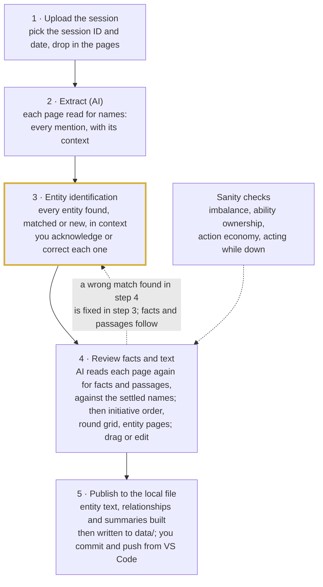

# Chronicle Intake Redesign

Oct 20, 2026 · David Grimes

*Design document for the intake rebuild. Exported from the working design doc on 20 October 2026.*

A session goes from photos to published data in five steps: upload, extract, identify entities, review facts and text, publish to the local campaign file. You confirm once which people, places, things and events the notes refer to. Combat facts and your narrative notes then attach to those entities, and relationships are computed from them, so a correction never has to be chased through the data.

## The problem

The current flow has about 25 actions and decisions per session, and most of them re-check the same facts. The controls were added to catch AI errors, but they sit in the wrong places.

- **The same facts are reviewed three or four times.** OCR text against your notes, then interpreted rounds against the same notes, then one approve click per item, then the publish confirmation.
- **Two AI passes, two reviews.** OCR turns the image into text, then Interpret turns that text into data. Each pass adds errors, and the second never sees the image.
- **Errors cascade through relationships.** Relationships are detected from raw OCR text before any correction. Round targets are free text, not links. A wrong name in one place leaves wrong or missing relationships that you have to find and fix by hand.
- **Narrative notes are mostly lost.** NPC conversations and your exposition become one-sentence entity stubs at best. The page summary is shown for reference and never saved, and the OCR prompt asks for combat format, so prose can be dropped before review.
- **Ground-truth propagation is a workaround.** It substitutes words across every queue item because nothing links derived data back to its source fact. It has already rewritten words it shouldn't have (fixed in July).
- **Plumbing adds steps and loses work.** The sessionStorage handoff, the Drive round trip, and the manual download-and-commit each add clicks and are each a place where edits get lost.

## The new flow



Step 3 is the one careful check. The AI does the reading; you settle what each name, place and event refers to; facts and narrative attach to those answers. The current 12 steps and their sub-steps collapse into these five because review happens once, on the data that gets published.

## Identity first

Everything the notes mention is an entity, and every fact and every passage of narrative points at its ID, never at a copied name. Confirm what the notes refer to once, and everything that refers to it follows. The entity list covers every kind the data tracks:

| Kind | Arrays in the data | Mentions matched in step 3 |
| --- | --- | --- |
| People and creatures | `npc_directory`, `bestiary`, `factions`, `cohorts` | "the wizard" → The Low-Level Wizard; "goblins" → Goblins |
| Places | `locations` | "Bel" → Belfar (`loc_006`); a place not yet recorded |
| Things | `inventory_and_loot` | the Immovable Rod; coins found |
| Events | `combat_encounters`, `quest_ledger`, `character_moments` | "ambush continues" → Goblin Ambush (`cbt_005`); "the escort" → Escort to Lake Town |
| Knowledge | `world_lore` | something an NPC told the party; background you explained |

Matching events is what keeps a combat together across pages: a page that continues the ambush is matched to `cbt_005`, not treated as a new fight.

Each layer of data then hangs off the confirmed list:

| Layer | What it holds | Produced by | Checked by | Edited directly? |
| --- | --- | --- | --- | --- |
| Session header | ID, date, title, summary | You pick ID and date at upload; AI drafts title and summary from the passages | You | Yes |
| Entity list | Every person, place, thing, event and piece of knowledge mentioned, matched to an ID or marked new | AI proposes | You, once per session | Yes: link to existing, separate as new, or mark as sub-type |
| Facts | Combat rounds, quest progress, loot changes | AI, using confirmed IDs only | You, a quick scan | Yes, inline |
| Narrative passages | NPC conversations, your exposition and descriptions, rewritten as complete sentences with abbreviations expanded and no facts the notes don't contain, attached to the most specific thing they describe, with who said them | AI splits and tags | You, wherever it attaches | Yes |
| Entity text | Descriptions, personality, lore content, quest motivation, key moments | Proposed from the passages as a change to the current text | You accept or edit | Yes |
| Judgment events | Character moments and significant relationships; allegiance changes when stated or directly implied by a change of role; deaths and revivals only when the notes state them; an item's holder when the notes state it | AI flags, attached to an event | You approve | Follows its event |
| Derived | Combat participation, `npcs_met`, `locations_visited`, combat sessions and round counts | Computed at publish | Automatic checks | No, always recomputed |

### Where a passage lives

A passage attaches to the most specific thing it describes, and every level of the schema can hold one. A description of what Lake Town is like belongs to Lake Town. The party arriving there with the cart and the bodies is an event that happened at Lake Town, so it belongs to the session's account of that arrival, which links to Lake Town. The Ogre bursting from the treeline belongs to round 1 of the Goblin Ambush.

| Attached to | Typical passage |
| --- | --- |
| A person, creature or group | What they look like, how they speak, what they said |
| A place | What it is like, its history |
| A thing | What it looks like, where it came from |
| A combat, round or single activity | How the fight opened, a moment in a round, how a blow landed |
| A quest progress entry or character moment | What happened at that step, and why it mattered |
| The session | Scene-setting and transitions that belong to nothing narrower |

In the data this is one optional `passages` list on each of those objects. Each passage holds its text, the session, who said it (you or an entity ID) and the page it came from. Nothing is copied: a place's page shows the events linked to it, rather than holding their passages a second time. The AI proposes where each passage attaches, and in step 4 you can re-attach one by moving it to the right entity, event or round.

Who said something matters. Your exposition is fact; what an NPC tells the party is testimony. Lore already records this in `reliability` and `source_type` (`npc_testimony` is in use), so a rumor never becomes a confirmed description. Generated flavor text stays downstream: the Gemini module writes it from confirmed entity text, never from raw notes.

In practice, round slots store `actor_id` and `target_id` instead of `"goblin"`. When you merge "Bel" into Belfar (`loc_006`), every round, passage, quest entry and relationship that pointed at "Bel" now points at Belfar, with no search and replace. The entity list is the ground-truth registry, built and confirmed up front instead of reconstructed from your corrections.

## Step 3: Entity identification

Step 3 finds every entity in the session notes, matches each against the campaign, and shows each one in the context where it appears. You acknowledge it or correct it. Nothing downstream is built until every entity is settled.

Each row shows:

| Column | What it shows |
| --- | --- |
| Kind | Person or creature, place, thing, event, or knowledge |
| As written | The words in the notes, such as "Bel" or "gob archer" |
| Match | The existing entity it matched, by name and ID, or **New** |
| Context | The sentence or round where it appears, with the page number; every occurrence when there is more than one |
| Status | Acknowledged or corrected |

New entities and inexact matches come first, reviewed row by row. Exact matches come last: the words in the notes equal an entity's name or one of its recorded aliases. Those can be acknowledged together with Bulk acknowledge. The AI's own confidence never decides this, and a Link to existing adds an alias unless you untick "save as alias", so the exact matches grow with each session.

| Action | Use it when | What it records |
| --- | --- | --- |
| Acknowledge | The match, or the new entity, is right | The confirmation |
| Link to existing | A new entity is really one you already have: a typo, abbreviation or alias ("Bel" → Belfar). It can also link to an entity another row creates this session | The alias on the existing entity, so later sessions match it automatically. "Save as alias" is ticked by default; untick it for words that are right here but would mislead later, such as "#1" or "Combat Ended" |
| Separate as new | A match is wrong because two names look alike, and every occurrence belongs to the new entity | A new entity, plus a note on the existing one so the two are not confused again |
| Split | One identified entity is really two (or more) in this session | The new entities only; each occurrence is assigned to one of them in step 4 |
| Mark as sub-type | The same creature playing a different role in one combat: goblins in melee versus goblins standing back with slings | A group in that combat's enemy roster with a role such as melee or slinger, pointing at the creature: rounds and narrative track "Goblin Slingers" separately, while the bestiary keeps one Goblins entry |

Each action applies to every occurrence at once, which is what stops one misreading from spreading.

Sub-types use a structure the data already has. Each combat's `enemies_roster` lists groups with their own `actor_id`, and enemy turns are logged against them; `cbt_005` already has "Goblins" and "Goblin Slingers". The difference is where a group points: today the slingers point at their own bestiary entry, Goblin Slinger (`mon_006`). Under this design they point at Goblins (`mon_004`), and a genuinely different creature, such as a goblin boss with its own abilities, stays a separate bestiary entry through **Separate as new**.

The combat view is unaffected by folding, because it labels enemies from the roster group's `actor_id`, not from the bestiary. Round 2 of the Goblin Ambush still reads "Goblins: melee attacks" and "Goblin Slingers: Sling, hit for 7 on Del". Only the bestiary changes: one Goblins entry whose page lists both roles, built from the rosters.

### When one entity is really two

The hard case is the AI merging two distinct entities from the same session, each with several actions. Splitting them works because every fact points at the **occurrence** it came from, and each occurrence points at an entity. A round action or a passage is never tied to the entity directly, so reassigning an occurrence carries its actions and passages with it.

In step 3, Split only decides what exists: you name the entities (A, B, or one linked to an existing entity). Assigning each occurrence happens in step 4, where each action sits in its full round and each passage on its entity page. That is the best context for telling A from B.

- **The AI pre-sorts.** Each split occurrence arrives in step 4 marked "needs assignment", with a proposed A or B and the reason: spelling as written, location, who else is present, which combat.
- **Assign in bulk.** By spelling (all "Hank" to B), by page, or by combat, then fix the exceptions.
- **Unclear stays unclear.** An occurrence you cannot place stays unassigned and holds back only its own facts from publishing, not the session.

This depends on keeping each occurrence's original wording. Extraction never normalizes a name away, so a split can always fall back on how the notes wrote it.

The merge is also caught early. An automatic flag fires when one entity acts twice in the same turn, appears in two places at once, or is described in ways that conflict, such as two different roles or allegiances in one scene.

## Step 4: Reviewing a combat

A combat is reviewed in two passes that follow the data's own structure: confirm the initiative order once, then review the turns against it. Every turn points at an initiative slot, not at an entity, so fixing the order fixes every round at once. It is the same idea as occurrences in step 3.

The structure is: **combat → initiative order** (slot → entity, with the round it joins or leaves) **→ rounds → turns** (one per slot per round) **→ the turn's activities, each tagged with the economy it spends → their outcomes.**

Your schema already has this shape. Each v4 slot holds `action` (with `attacks` for multiple rolls), `bonus_action`, `reaction`, `movement` and `object_interaction`, and every combat has an `initiative.entries` list that is empty today. The Interpret pipeline breaks the shape by writing one flat entry per roll instead of one turn per slot.

### Pass 1: confirm the initiative order

The AI proposes the order from the notes, usually from round 1. You drag rows into place once. An entry can join late or drop out, such as the Ogre arriving at the end of round 1 in the Goblin Ambush.

The order rarely changes in practice. In the Siege of Bagyers Farm (`cbt_002`), 18 of 19 rounds have the same order, and the 19th only drops one PC. A round that really differs, such as a surprise round, gets its own override.

Enemies are not part of the order. Your notes record them in a section at the end of each round, so the grid shows enemy groups as a block below the party, one row per roster group. An enemy's effects count as happening sometime during its round: a PC downed by an enemy can still act or be healed in that round without a flag, and the state checks apply from the next round. In the Goblin Ambush round 2, the slingers down Del and Att heals him in slot 3; that is consistent, and nothing is flagged.

### Pass 2: the round grid

Each combat shows as a grid: one row per initiative slot, one column per round, and each cell is that turn's action, bonus action, reaction and movement. Here is the Goblin Ambush as recorded today:

| Slot | Round 1 | Round 2 | Round 3 |
| --- | --- | --- | --- |
| 1 · Del | Move | Unarmed ×2 | Unarmed ×2 |
| 2 · Mal | Dash | Melee, hit 16 | Melee, miss |
| 3 · Att | Entangle | Cure Wounds, 5 | Ice Knife, 8 |
| 4 · Goli | Shortbow, 10 | Shortbow, 10 | Shortbow, 14 |
| 5 · Ash | Eldritch Blast, 13 | Witch Bolt, 12 | Eldritch Blast, 7 |
| 6 · Gold | Fire Bolt, miss | Magic Missile, 9 | Sleep |
| Goblins | Advance to flank | Melee | Melee, 4 to Mal |
| Goblin Slingers | Sling, 7 to Del | Sling, 7 to Del (Del downed) | Sling, 4 to Del |
| Ogre | Emerges at end of round | Greatclub, 10 to Mal | Greatclub, 12 to Mal (killed by Att) |

Each row reads as one character's fight, which is what makes misalignment visible: an Eldritch Blast in the monk's row stands out. Corrections are direct moves, with no AI call:

| Error | Correction | Fixes |
| --- | --- | --- |
| Entity in the wrong slot | Drag the row | Every round |
| Two turns swapped in one round | Drag one cell onto the other | That round |
| An action credited to the wrong turn | Drag the action to the right cell | That action |
| Wrong action type (action vs bonus action) | Pick the type on the action | That action |
| Missing action, attack or reaction | Add it in the cell | That turn |
| Reaction recorded under the attacker | Drag it to the reactor's row; it keeps a link to the turn it interrupted | That reaction |
| Entity joins or leaves mid-combat | Set its first or last round in the order | The order |
| A round too garbled to fix by hand | Re-extract that round with the confirmed order (AI) | That round |

These replace the AI sidebar's reorder and add-slot operations, which have been the least reliable part of the current tool. The AI is used only to re-read a round against an order you have already confirmed.

### What a turn holds

A turn records the entity's action economy and little else. Three names keep its levels apart:

- **Economy:** what the turn spends: `action`, `bonus_action`, `reaction`, `movement` or `free`. Bosses add `legendary_action` and `legendary_resistance`.
- **Activity:** what it was spent on. For an action, one of the standard actions: Attack, Dash, Disengage, Dodge, Help, Hide, Influence, Magic, Ready, Search, Study or Utilize. For a bonus action or reaction, the feature or spell, such as Flurry of Blows or Shield.
- **Outcome:** each result an activity produces: one attack roll, or one target of a spell. Each outcome resolves on its own (hit, miss or crit, or a save made or failed) with a value and a target.

These avoid "event" and "occurrence", which already mean an entity kind and a mention in the notes.

| Economy | Typical activities | More than one per turn? |
| --- | --- | --- |
| `action` | Attack, Magic (casting a spell), Dash, Dodge, Help, Ready, Death Save, No Action (with the reason) | Rarely (Action Surge) |
| `bonus_action` | Flurry of Blows, Cunning Action, a bonus-action spell | Rarely |
| `reaction` | Opportunity attack, Shield; records the turn or enemy activity it interrupted | Sometimes, since a reaction resets at the start of its owner's turn |
| `movement` | A significant move, before or after an attack | Yes |
| `free` | Commanding a familiar, an object interaction, a few words | Yes |
| `legendary_action` | A boss's attack or move at the end of another creature's turn; records the turn it followed and its cost | Recorded as used; pools are not tracked |
| `legendary_resistance` | A boss turning a failed save into a success; linked to the outcome it changed | Recorded as used; limits are not tracked |

An activity with no roll, such as Dash or Dodge, has no outcomes. A spell cast with the Magic action records the spell as its detail (Magic · Fireball) with one outcome per target. Del's turn from your example (values illustrative):

```json
{ "s": 1, "a": "pc_004",
  "activities": [
    { "economy": "action", "name": "Attack",
      "outcomes": [ { "res": "hit", "val": 6, "target_id": "mon_004" }, { "res": "miss" } ] },
    { "economy": "bonus_action", "name": "Flurry of Blows",
      "outcomes": [ { "res": "hit", "val": 5, "target_id": "mon_004" }, { "res": "hit", "val": 4, "target_id": "mon_004" } ] }
  ] }
```

The action economy is then a count of activities by economy: Del spent her action and bonus action and kept her reaction. The checks below work from the same counts.

Compared with today's slot: the five fixed fields (`action`, `bonus_action`, `reaction`, `movement`, `object_interaction`) become one `activities` list, and `attacks[]` becomes `outcomes`. A second reaction or several free actions need no new fields. Only four extras stay optional: `detail` (the spell or weapon), `val_type` (damage or healing), an `effect` such as downed or killed, and `notes`. The cost is one migration: the 42 recorded rounds convert mechanically, and `flattenSlot()` in both viewers reads the new list. Two outcome-level fields were added during the migration (#93): an outcome may carry its own `detail` (Claw, Bite) when one activity's attacks differ, and a target that is not an entity (a horse) goes in `target_text` with `target_id` null. One outcome per attack roll, even when the target repeats.

### Turns that don't go to plan

- **Death saves** are an action activity, Death Save, with one outcome: success or failure.
- **No action.** When a condition prevents acting, the action records No Action with the reason, such as "No Action: Paralyzed". Stunned, paralyzed and unconscious are reasons, not activities.
- **Down is an outcome, not an action.** The outcome that drops a creature to 0 HP carries the effect downed. Its later turns show Death Save or No Action until something brings it back.
- **Ready** uses the action: the activity is Ready, with its trigger. Releasing it uses the reaction, as an activity linked to the Ready it came from.

In the grid a turn reads as one line per activity, such as "A: Attack · hit, miss" and "BA: Flurry of Blows · hit, hit". You can drag a whole turn, one activity, or one outcome, and change an activity's economy when it was logged under the wrong one.

### Enemy groups

Enemies often act as a group: five goblins recorded together in the round's enemy section, each with its own action, bonus action and reaction. The group is one row in the grid, and its turn holds every member's activities, so five goblins can take five actions.

- **The group is the roster entry.** `enemies_roster` already has a `count`. Members are not separate entities, and the bestiary keeps one Goblins entry.
- **Members are named only when the notes tell them apart.** An activity takes an optional `member` (goblin 3). "Goblins attack Mal three times, two hit" records as three Attack activities with no member.
- **The count is recorded only when it is known at the start.** It is not reconciled round by round. When a starting count exists, a round with more group actions than that count is flagged; when it does not, there is no check.
- **Sub-type groups stay separate.** The slingers are their own roster group and their own row.

In the grid a group's cell shows one line per economy, such as "A ×5: Attack · hit, hit, miss, miss, hit", and expands to show each member where the notes named them.

### Bosses

Boss monsters add two economies. Chronicle records that they were used, not whether they were used within the rules.

- **Legendary actions** happen at the end of another creature's turn. Each costs one or more points from a pool that refills at the start of the boss's turn, usually 3 per round. In the grid they sit in the boss's row, marked with the turn they followed when the notes say so.
- **Legendary resistance** turns a failed saving throw into a success, a limited number of times per day, usually 3. The activity links to the outcome it changed, so the PC's spell shows "failed → saved (Legendary Resistance)" and the boss's row counts the use.
- **Lair actions,** for a boss that has them, act at initiative 20 as their own row.

Legendary actions and resistances are recorded as they were used. Pool sizes are not tracked, and nothing checks whether a boss stayed within its limits. The current schema reference already describes legendary and lair entries (`legendary_action_cost`, `initiative_position`).

### A mixed misalignment in one round

The hardest error seen in testing is a single round where some entities sit in the wrong initiative slot, and their actions sometimes travel with them and sometimes land on the wrong entity. It happens because the AI decides two things at once: which entity is in each slot, and which entity took each action. The design separates them.

- **The AI never assigns slots.** Extraction attributes each action to the actor the notes name, as an occurrence from step 3, and places nothing by slot number. The grid puts each action in its row by looking the actor up in the confirmed order. An entity can no longer be in the wrong slot for one round, so half of the mixed error cannot happen.
- **Every action keeps the line it came from.** Each action carries the excerpt of the notes that produced it, with the actor as written. An action whose source line names a different character than its row is flagged automatically.
- **What remains is a misattributed action, and one move fixes it.** Drag the action, or the whole turn, to the right row; a flag that knows the likely owner offers that move in one click.

For example, if Att's Cure Wounds lands in Goli's row, it is flagged twice: Cure Wounds is not on Goli's ability list, and its source line names Att. The flag offers "Move to Att", and nothing else in the round changes.

### Checks that find misalignment

These are sanity checks, not controls. They do two jobs: the AI runs them on its own output before returning a round, and re-reads the round when one fails; and in review they highlight cells likely to be misread. None of them blocks publishing.

- **Imbalance:** in one round, one character has two actions and another has none. This is the classic misread of cramped notes, and the first check the AI runs on itself.
- **Source line:** the excerpt an action came from names a different character than the row it sits in.
- **Ability ownership:** an action not on that PC's list in `pc-abilities.json`, such as a spell in the monk's row.
- **Action economy:** more than one action or bonus action in a turn without a feature that allows it, such as Action Surge, or a group with more actions than its recorded starting count; an activity logged under the wrong economy, such as Flurry of Blows as the action.
- **Outcome count:** an activity has more or fewer outcomes than the notes or the feature imply, such as an Attack action that does not match the PC's number of attacks. Today's data has one: in `cbt_002` round 4, Goli's "3 Melee Attacks" has two attacks recorded.
- **State:** an entity acting after it was downed or killed (from the next round, for effects caused by enemies), or before it joined, unless something in between explains it (a heal before its turn); a downed or incapacitated entity with anything other than Death Save or No Action; a released readied action with no Ready before it.
- **Round order:** the notes list a round's turns in a different order from the confirmed initiative order, which points at a misread round.
- **Duplicates:** the same action with the same result and value in two cells of one round.
- **Gaps:** an active entity with no turn in a round. Often legitimate (down, absent).

## Where your review goes

Review effort follows how far an error spreads. A wrong identity corrupts everything that mentions it; a wrong damage number affects only itself.

| Check | When | Your effort | Catches |
| --- | --- | --- | --- |
| Entity identification | Step 3, once per session | Row by row for new and inexact matches; exact name or alias matches acknowledged in bulk | Misread names, wrong existing match, duplicates, monsters filed as NPCs, a continuing combat treated as new |
| Round grid | Step 4, one grid per combat | Scan each row against your notes; drag or edit | An action in the wrong row or round; wrong action, result or number; missing bonus action or reaction |
| Initiative order | Step 4, once per combat, before the rounds | Drag rows into place | An entity in the wrong slot, which would misalign every round |
| Split assignments | Step 4, only after a split | One choice per occurrence, pre-filled by the AI | Actions and passages credited to the wrong one of two similar entities |
| Entity pages | Step 4, one page per entity or event touched this session | Read the new passages and the proposed text change | A passage attached to the wrong entity or event, an NPC claim recorded as fact, detail the notes never gave |
| Judgment events | Step 4 | Approve or drop each | Overstated events, such as 0 HP read as death |
| Automatic flags | Always on, no clicks | Only when something is flagged | Unknown actor, round gaps, damage over 100, a name close to an existing one, a round split across pages, one entity acting twice in a turn or in two places at once |
| Section approval | Step 4 | One click per section | Confirms you finished reviewing |

The separate OCR text review goes away. A misread word surfaces in the entity list, a round table or an entity page, where it matters. The screen stays devoted to the data; you check against your physical pages, as now.

## What changes in the code

`intake.html` and `delta-review.html` become one session page. Most of the hardening from work units 1.8 and 1.9 carries over.

| Current piece | Fate | Notes |
| --- | --- | --- |
| Upload zone, image compression, campaign and PC-ability context | Keep | Add session ID and date pickers, including "fill placeholder session\_006" |
| OCR to text, per-page text review, re-run with steering | Replace | Two vision calls per page: names and mentions before step 3, then facts and passages against the settled names. No transcript review step; source lines are kept with each fact and passage |
| OCR prompt in combat-round format | Replace | Prose, dialogue and exposition are first-class output, not dropped |
| Consolidation, Step 4 summary, sessionStorage hand-off | Remove | One page; saved state waits for Postgres |
| `detectRelationships()` | Remove | Relationships are computed at publish |
| Interpret button and per-page combat selector | Remove | Combats are matched as events in the entity list; a round-counter reset is flagged |
| Narrative extraction (#90) | Rebuild | Produces passages tagged to entities and speakers instead of one-line entity stubs; the page summary is saved, not discarded |
| Per-item queue with approve on every item | Rebuild | Sections: entity list, initiative order and round grid per combat, entity pages, session header |
| Inline editing of rounds and entity cards (#84, #85) | Keep | Becomes the main way to correct |
| AI correction sidebar, reorder and add\_slot (#86) | Replace | Structural fixes become direct moves on the round grid; the AI only re-reads a single round against the confirmed order |
| Ground-truth propagation (#57) | Remove | Replaced by ID references |
| Name index and duplicate check (#56), cohort detection (#62) | Keep | Move into entity-list matching |
| `chronicle-integrity.js` gap checks | Keep | Run on every change as flags; no Accept/Defer gate |
| `chronicle-narrative.js` (Gemini) | Keep | Writes flavor text and chronicle entries from confirmed entity text only |
| Publish confirmation panel (#37) | Fold in | Becomes the summary above the Publish button |
| `applyDeltasToCampaign()` | Rebuild | Writes the v4 shapes the viewers read, fills placeholder sessions, merges accepted entity text, computes derived fields |
| Drive backup, read and write | Replace | Publish writes `data/magers-campaign.json` in the local clone (File System Access API, run from Live Server); you commit and push from VS Code, and git history is the backup. The Versions page's Drive backups and drive-test.html retire with it |
| Safe Test Mode | Keep | Writes a separate git-ignored test output file; the real campaign file and the test fixture are never written |

## What this resolves

Every blocker in the October review is either removed by the design or becomes a single fix in a rebuilt piece.

| Blocker today | In the new design |
| --- | --- |
| Published rounds unreadable by the viewers | Rebuilt publish writes the nested v4 slot shape, tested through the real viewer code |
| Session is always `session_006`, dated today, published as `session_008` | ID and date chosen at upload; placeholder sessions are filled, not duplicated |
| Review work lost on reload or navigation | One page, so no navigation between pages; saved state arrives with Postgres |
| New combat not selectable on later pages; split rounds overwritten | Combats are matched as events across pages; a split round merges and is flagged |
| Integrity check never sees interpreted rounds | Checks run on every change |
| Relationships built from uncorrected text | Computed from confirmed facts at publish |
| Correction cascade through entities | One correction in the entity list updates every reference |
| NPC conversations and exposition lost or reduced to stubs | Kept as passages on the entities they describe, with the speaker recorded |
| Corrections sent without history; demo diffs shown on API error | Structural fixes are direct moves on the grid; API errors show as errors |
| Fixed slot-to-PC roster in prompts | The AI attributes actions to named actors only; slots come from the confirmed initiative order |
| Manual Drive-to-repo sync | Publish writes the local file directly; committing it is an ordinary VS Code commit |
| Silent truncation at 4,096 tokens | Higher output limit; a truncated response is flagged and retried |

## Build order

Fix publishing first; every later phase depends on data landing correctly. Each phase ends with a test you can run.

1. **Publish that writes correct data.** Rebuild `applyDeltasToCampaign()` to write the v4 shapes, fill placeholder sessions and compute derived fields. Move the tests onto the real page code. Migrate the 42 recorded rounds to the new turn schema, and fold Goblin Slinger into Goblins. Give every entity, combat, session and moment an opaque ID in Storyteller's format, rewrite every reference to match, and keep each old typed ID as a legacy reference so existing links and notes still resolve. Update the ID rules in CLAUDE.md and the README. Put every read and write behind one storage module (load the campaign, publish a session, and later save a draft), so the Postgres move in phase 7 changes only that module.
   - Gate: a sample session publishes and renders correctly in both the log viewer and the player view, and every reference in the migrated JSON resolves to an existing opaque ID.
2. **Local publish.** Publish writes `data/magers-campaign.json` in the local clone through the File System Access API, from the page served by Live Server. It stops if the file changed on disk since it was loaded, and Live Server is set not to reload on data writes. Committing and pushing stay in VS Code, on your schedule. Retire Drive.
   - Gate: a Safe Test Mode publish writes the test output file, leaves the real campaign file and the fixture unchanged, and does not reload the page.
3. **Entity identification.** Find every entity in the notes, match it against existing entities, cohorts and combats, and show each in context. Support acknowledge, link to existing, separate as new, and mark as sub-type.
   - Gate: on one real session every entity is settled, and a link to existing updates every reference and saves the alias.
4. **Facts and passages against IDs.** A second structured call per page, made after step 3, carrying the settled entity list and open combats forward. Narrative is split into passages tagged with their entities and speaker. Automatic flags run throughout.
   - Gate: a combat that crosses a page break comes out as one combat, and an NPC conversation lands on that NPC's page.
5. **Section review, entity text and computed relationships.** Initiative order and round grid for each combat, ability and action-economy checks, entity pages with proposed text changes, relationships computed at publish.
   - Gate: issue #17, the end-to-end run in Safe Test Mode, passes on one real session.
6. **Start the backlog,** beginning with the `session_006` and `session_007` placeholders.
7. **Move to Postgres,** after the backlog is in. Set up Render and managed PostgreSQL per Hosting.md, with a local development database alongside it, and replace the storage module's local-file calls with calls to an API backed by the database. Saved review drafts arrive here, and so does the rollout to players: the player view, passages in the player view, and generated narrative display.
   - Gate: the intake runs unchanged against the database, and players can read the campaign from the hosted site.

## Later: database and hosting

The local JSON file, versioned in git, is a stepping stone, replaced in phase 7 of the build order. The long-term home is the platform already settled in the Malvasia-Plays-DCC delivery docs ([Hosting.md](https://github.com/dgrimesii/Malvasia-Plays-DCC/blob/main/_delivery/Hosting.md)): Render for the application and managed PostgreSQL, Cloudflare for DNS and backup storage, and `chronicle.warpandweft.ink` reserved for Chronicle. That document also notes that Chronicle's own v5 milestone chose PostgreSQL with JSONB independently.

This design is shaped to move there without rework:

- **The model maps onto the shared core.** Entities, events, facts, relationships and sessions are the core that Hosting.md says every tool shares; Chronicle's identity-first model already separates them the same way.
- **Turns and passages are JSON-shaped.** The `activities` and `outcomes` lists and the optional `passages` lists fit JSONB columns, so the schema can keep settling without a migration per field.
- **Relationships are derived,** which suits a store where they can be computed in the query instead of maintained by hand.

**Identifiers follow Storyteller.** Storyteller's hosting plan requires opaque, non-sequential identifiers (C15). Chronicle has no such requirement of its own, but the platform should be consistent, so Chronicle adopts the same kind of ID instead of its typed sequential IDs such as `npc_014`. Names and aliases carry readability; the ID is only a reference. The switch happens in phase 1, while the data is small and before the backlog adds to it.

## Decisions

Decided on 20 October 2026:

- **Turn schema:** one `activities` list tagged by economy, with `outcomes` for rolls and targets.
- **Death saves:** an action activity, Death Save.
- **Conditions and readied actions:** down is an outcome effect, not an action. A turn a condition prevents records "No Action" with the reason. Ready uses the action, and releasing it uses the reaction.
- **Narrative passages:** cleaned up and fleshed out from the notes, not extensively generated. Abbreviations and fragments become complete sentences, and no new facts are introduced.
- **Where passages live:** each attaches to the most specific thing it describes (an entity, an event, a round or an activity) through an optional `passages` list available throughout the schema.
- **Enemies and initiative:** enemies have no slots. Their activities are recorded per round as a block after the party, and their effects count as happening sometime during that round.
- **Enemy group counts:** recorded only when known at the start of a combat, with no round-by-round reconciliation.
- **Checks are sanity checks:** they guide the AI's extraction and highlight likely misreads in review. None blocks publishing.
- **No OCR text review:** removed, with no optional transcript view. In testing it guarded against errors that were not happening and offered no real way to correct the OCR. The transcript survives only as the source line kept with each fact and passage.
- **Aliases:** every entity has a `name` and an optional `aliases` list.
- **Enemy roles:** each `enemies_roster` group can carry a `role`, such as melee or slinger, to tell groups of the same creature apart.
- **Goblin Slinger folds into Goblins:** during the migration, the Goblin Ambush roster's Goblin Slingers group points at Goblins (`mon_004`) with role slinger, the slinger's observed abilities move to Goblins tagged slinger, and `mon_006` is voided and never reused.
- **Publish to the local file; retire Drive** (revised 23 October 2026): publish writes `data/magers-campaign.json` in the local clone. Chronicle runs locally from VS Code with Live Server for the near future, and committing and pushing are done in VS Code, separately from the tool, on your schedule. The page never talks to GitHub and needs no token. Git history is the backup once committed. The Drive proxy, the Versions page's Drive backups and `drive-test.html` are retired. (This replaces the 20 October decision to commit through the GitHub API.)
- **Opaque identifiers:** Chronicle adopts the same opaque, non-sequential IDs as Storyteller, for consistency across the platform rather than because Chronicle requires them. They arrive in phase 1, before the backlog.
- **Judgment events:** the AI proposes character moments and significant relationships freely. Deaths and revivals are never assumed; they are proposed only when the notes state them.
- **Items are not inventory:** an item's holder is an optional attribute, recorded when the notes state it (a specific PC, the party, or another entity) and otherwise left unknown. Intake does not track every transfer. Existing holders, such as Ched's Map with Goli, stay as recorded facts.
- **Allegiance changes:** proposed when the notes state one, or directly imply one through a change in the NPC's role, such as a captive becoming a guide. They are treated as narrative: an event on the NPC with its passage, which the NPC's disposition then follows.
- **Boss pools:** not tracked. Legendary actions and resistances are recorded when used, with no check against a boss's limits.
- **Bulk acknowledge uses a strict rule:** only exact matches on an entity's name or a recorded alias qualify. Everything else is reviewed row by row, and the alias list grows from every Link to existing (unless "save as alias" is unticked for that link).
- **Saved review state waits for Postgres:** until then, an unpublished review lives only in the open page, so each session is reviewed in one sitting and a reload loses unpublished work. Live Server must not reload the page during review: exclude `data/` and `tests/` from its watch, or turn its auto-reload off.
- **The backlog waits for the rebuild:** no sessions are processed until phase 5 passes. Then every backlog session goes through the new flow, starting with the `session_006` and `session_007` placeholders.
- **Postgres comes after the rebuild:** the rebuild keeps local-file publishing, with all storage behind one module. The move to Render and PostgreSQL is phase 7, after the backlog is in.

Decided on 23 October 2026:

- **Scope of the rebuild is session capture:** phases 1–6 are done when a session's note images can be taken through intake with the review and checks ensuring quality, published to the local file, and viewed in the admin log viewer. Rollout to players (the player view and anything shown only to players) moves to phase 7, with web hosting.
- **Two AI reads per page** (found in #100 and #101): names are read first, in step 2, and settled in step 3. Each page is then read again for facts and passages, which can point only at settled occurrences. This replaces the one call per page described earlier, and is what keeps every fact pointing at a confirmed entity.
- **"Save as alias" on Link to existing** (#100): ticked by default. Untick it for words that are right in this session but would match the wrong thing later.
- **A misread that lands as an event:** extraction sometimes records a line of attacks as an event (session 6: "Hit - Dragon, Dragon, Oregon"). The round grid (#103) can turn an event into attacks as well as move and edit them.
- **The session page's Publish step** (step 5) is owned by #106, together with the relationships computed at publish. Passages on rounds, activities and quest steps are written there too.
- **Attendance is a session note** (#112): a player's absence and who ran their character ("Lance out work, played by David") is a note about the session, not a fact about the PC. It is a plain sentence in `session_logs[].narrative.absence_notes`, first names only, with no PC id, omitted when there is no absence. The three absences already recorded in the old PC-fact shape were migrated and `mechanics.player_absences` removed. Schema 5.0.1.

## Open questions

None open. New questions that come up during the build belong here.
