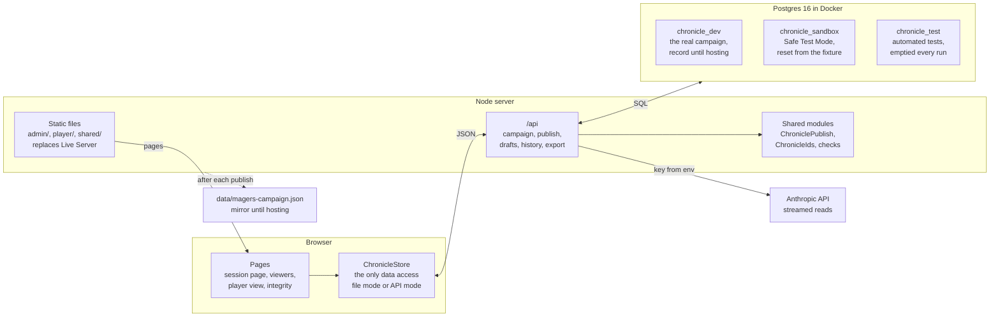

# Chronicle Phase 7 — Postgres migration plan

Oct 25, 2026 · David Grimes

*Plan for phase 7 (epic #121): moving campaign storage from the repo to Postgres. Hosting and the player rollout are phase 8 (#6). Exported from the working plan doc on 25 October 2026; updated the same day with the phase 7 definition of done, server-side API keys, what phase 7 does to be ready for the shared IAM, and the two CLAUDE.md rules it changes. Open questions are at the end.*

## Summary

Phase 7 moves the campaign data out of `data/magers-campaign.json` and into Postgres, behind a small Node API, without changing how the pages behave. Every page already reads and writes through one module, `shared/chronicle-store.js` (#96), so the browser side changes in that file, in `chronicle-ai.js` (which stops holding the API key) and almost nowhere else. Every step is built and tested against the local Postgres container before anything is hosted.

What this plan delivers, in order:

- A Node server that serves the pages and an `/api`, replacing Live Server.
- A schema and an import that loads the current campaign, proven by exporting it back to identical JSON.
- Reads, then publishes, through the API, with each publish recorded in the database instead of in git.
- Saved review drafts, so a reload no longer loses review work.
- API keys held only by the server: the browser calls Anthropic through the server and never sees a key.
- Automated tests against a throwaway test database, and Safe Test Mode against a sandbox database.

It rests on decisions already made in #6 and the Malvasia [Hosting.md](https://github.com/dgrimesii/Malvasia-Plays-DCC/blob/main/_delivery/Hosting.md): PostgreSQL with JSONB, Render later for hosting, the opaque UUIDs from #95, and the storage module as the single seam.

**Phase 7 is complete when the session intake is fully migrated to Postgres and could be moved to Render as it stands, with its API keys safe in a hosted space.** All three parts are spelled out under "Definition of done" at the end of the work breakdown.

Out of scope here, and left to phase 8 (#6): deploying to Render, Chronicle's place in the shared IAM (its roles, entitlements and sign-in, plus infrastructure access), and the player rollout. The plan is shaped so they follow without rework.

## Where storage stands today

All campaign data is one 343 KB JSON file at schema 5.0.1, and every page reaches it through `ChronicleStore`. Nothing reads Postgres yet. As of `4a31b0c`:

| What | Lives in | Read by | Written by |
| --- | --- | --- | --- |
| Campaign data | `data/magers-campaign.json` | `ChronicleStore.loadCampaign()` on 7 pages: session, intake, delta review, integrity, log editor, log viewer, player view | `ChronicleStore.publishSession()` through the File System Access API; the `scripts/migrate-*.js` migrations; hand edits |
| Publish base | The same file, read from disk in your clone | `loadPublishBase()` | Publish stops if the file changed on disk since it was loaded |
| History and undo | Git history; `data/magers-campaign.prev.json` (git-ignored, one step back) | You, in VS Code | `publishSession()` keeps the previous file before overwriting |
| Safe Test Mode | `tests/fixtures/test-campaign.json` in, `tests/output/test-campaign.published.json` out | `loadCampaign()` in test mode | `publishSession()` in test mode; the fixture is never written |
| PC ability sheets | `data/pc-abilities.json` (level 4, live) and the level 4 and level 5 snapshots | Direct `fetch()` in session, intake and delta review pages and `chronicle-ai.js`, not through the store | `scripts/harvest-characters.js` |
| Review drafts | Page memory only | `loadDraft()` is a stub that rejects | `saveDraft()` is a stub that rejects |
| Settings and keys | `shared/config.js` (git-ignored): `safeTestMode`, Anthropic and Gemini keys | `chronicle-store.js`, `chronicle-ai.js` | You |
| Postgres | `local_postgres` container, `postgres:16-alpine`, port 5432, credentials from `.env` (`a1799f8`) | Nothing | Nothing |

The file holds 10 populated collections (party 6, session_logs 7, npc_directory 11, bestiary 7, locations 13, inventory_and_loot 11, quest_ledger 5, combat_encounters 6, character_moments 3, world_lore 3), 4 empty ones (entity_relationships, factions, cohorts, prompt_improvement_log), `meta`, and the schema documentation blocks (`_about`, `_design_principles`, `_field_type_reference`, `_id_registry`). Publish can also create `deferred_gaps`.

Three things matter for the move:

- **Publish replaces the whole document.** `applySession()` runs in the browser and returns a new campaign; the store writes it whole.
- **The repo has no `package.json`, and CLAUDE.md forbids npm packages.** Every test runs on plain Node with no dependencies, and CLAUDE.md's file conventions say "zero npm packages, zero build steps". The server is the project's first npm dependency set, so that rule has to change first (P7-2, below).
- **Leftovers to retire:** `scripts/build.js` still rebuilds an `EMBEDDED_DATA` block that neither viewer contains any more, and `data/magers-campaign.json.old` is still tracked.

## Target architecture

One Node server serves the pages and a JSON API, and it is the only thing that talks to Postgres or holds an API key; the browser never connects to the database or to Anthropic. Locally it runs beside the Postgres container. On Render the same server runs against managed Postgres.

`/api` is the new seam, and the only holder of the API key. The dotted link is temporary: the mirror file ends when hosted backups exist.

- **The server serves the pages too.** One origin means no CORS, the pages' relative paths keep working, and Live Server's reload problems go away. `npm run dev` replaces Live Server.
- **Node, because the shared modules already run on it.** The tests `require` them today, so the server can reuse `ChroniclePublish`, `ChronicleIds` and the integrity checks. Suggested stack, to be ratified in an ADR as Hosting.md asks: Fastify, `pg` and `node-pg-migrate`, in a new `server/` folder.
- **npm packages on the server only.** The browser side stays as CLAUDE.md requires: vanilla HTML, CSS and JS, no framework, no bundler, no build step. Packages are allowed only under `server/` (and its tests), recorded in the ADR and in CLAUDE.md's file conventions.
- **The API keeps the store's contract.** `loadCampaign()` still returns the raw 5.0.1 JSON, so no page changes how it reads or normalises data.
- **Stage 1 still applies publishes in the browser.** The page sends the new campaign and the version it was built on. The server writes the difference in one transaction, or refuses with 409 if the version moved, which replaces the "file changed on disk" check.
- **Stage 2, later and optional, applies them on the server.** The page sends the approved queue items and the server runs `applySession()` on the current data. This removes the whole-document upload; with one DM it is not urgent.
- **AI calls go through the server.** The browser stops calling Anthropic directly; see "API keys" below.
- **Configured only by environment variables.** `DATABASE_URL`, `PORT`, `ANTHROPIC_API_KEY`, `DM_ACCESS_TOKEN`, `DM_IDENTITY` and a mirror switch, as Render supplies them; nothing reads a path outside the repo, so the same server moves to Render unchanged.

| Endpoint | What it does | Replaces |
| --- | --- | --- |
| `GET /api/health` | Server up, database reachable, schema version | — |
| `GET /api/campaign` | The assembled campaign JSON, with its version as the ETag | Fetching `data/magers-campaign.json` |
| `GET /api/campaign/base` | The same, for a publish to build on | `loadPublishBase()` reading the file from disk |
| `POST /api/campaign/publish` | Body: base version, new campaign, summary, session. One transaction; 409 if the version moved; returns the new version and publish id | The File System Access write and `.prev.json` |
| `GET /api/publishes`, `GET /api/publishes/:id` | Publish history, and the campaign as it stood after any publish | `git log` and `git show` on the data file |
| `GET`, `PUT`, `DELETE /api/drafts/:session` | Saved review state for one session | The `saveDraft()` and `loadDraft()` stubs |
| `GET /api/reference/pc-abilities` | The active ability snapshot; others by label (`level-4`, `level-5`) | Fetching `data/pc-abilities.json` |
| `GET /api/export` | The campaign as a JSON file with stable key order | The repo copy as the backup |
| `POST /api/ai/messages` | Forwards one Anthropic Messages request, streamed back unchanged, with the server's key | The browser calling `api.anthropic.com` with the key from `config.js` |

### API keys

Today the Anthropic key sits in `shared/config.js` and the browser sends it straight to Anthropic (`chronicle-ai.js`, with the `anthropic-dangerous-direct-browser-access` header). That is tolerable on your own machine and unsafe on any host: anyone who can load the page can read the key. Phase 7 moves every key to the server so the intake is safe to host.

- **Keys live only in the server's environment.** `ANTHROPIC_API_KEY` in `.env` locally (already git-ignored) and in a Render secret environment group per environment later. Test and production get different keys, so the test environment never holds a production credential (Hosting.md, rule 1).
- **The browser never receives a key.** `chronicle-ai.js` posts to `/api/ai/messages`; the direct-browser header and `anthropicApiKey` leave `config.js`. No API response, page or served file contains a key.
- **The proxy is narrow, not a pass-through.** It accepts only the Messages call, only the models Chronicle uses, a capped `max_tokens` and a capped request size (photos included), forwards no client headers, and streams the reply back as it arrives (the facts read needs streaming).
- **The proxy and every write are guarded.** In production mode, the AI proxy and all `/api` writes (publish, drafts) need a DM access token, set as the `DM_ACCESS_TOKEN` environment variable and entered once per browser session. Without it they answer 401, so a deployed server cannot be used to spend the key or change the campaign. Phase 8's IAM replaces the token with accounts. In development the server binds to `localhost` only.
- **Spend is capped and logs stay clean.** Each key gets a monthly spend limit in the Anthropic Console. Logs record the model, token counts and status, never a key, a photo or note text.
- **Rotation is one step:** create a new key, change the environment variable, restart, delete the old key. The README records the steps.
- **CLAUDE.md changes with it.** Its "Shared AI module rules" require the `anthropic-dangerous-direct-browser-access` header in every `chronicle-ai.js` call and the key in `config.js`, and its narrative rules put `geminiApiKey` there too. P7-7 rewrites those rules in the same change: keys only in the server's environment, every AI call through `/api/ai/messages`, the direct-browser header gone. Until P7-7 lands, the current rules stand.
- **Gemini:** only `intake.html` and `delta-review.html` call it (`chronicle-narrative.js`), and P7-1 retires them. When narrative generation (#45) returns, it uses the same proxy pattern with `GEMINI_API_KEY`.

### Ready for IAM

**Chronicle and Storyteller share one IAM system** (DM, 25 October). Once Storyteller goes live, Chronicle's access is just new roles and entitlements in it: for example, capturing and publishing sessions for a campaign, and reading a campaign as a player. Accounts follow the Malvasia [Two-Observer-Model](https://github.com/dgrimesii/Malvasia-Plays-DCC/blob/main/_design/Two-Observer-Model.md): one account per person, a password hash and a login, with no signup, invitations or admin screens. Phase 8 (#6) adds Chronicle to it. Phase 7 builds three things so that happens without reworking data or code:

- **Every write records its author.** `publishes.author` and `review_drafts.updated_by` are set on every write. Until IAM, the value is the DM's configured identity (`DM_IDENTITY`), never blank or "someone". The Two-Observer-Model is explicit that a shared credential loses who asserted each fact, permanently, so this cannot wait for accounts.
- **Access is checked in one place.** One server check answers "who is this request, and may they do this?" for every `/api` route. In phase 7 it accepts the DM token; in phase 8 it asks the shared IAM whether the signed-in account holds the Chronicle entitlement the route needs, and no route changes.
- **Two database roles from the first migration.** An owner role runs `npm run db:migrate`; the server connects as an application role that can read and write rows but cannot change the schema. Render's managed Postgres can carry the same split.

## Database schema

Each campaign object gets its own row with its body in JSONB, beside a version counter and a publish log; the API reassembles the 5.0.1 document from those rows. Turns, outcomes and passages stay JSON-shaped inside their objects, as #6 decided.

| Table | One row per | Main columns | Why |
| --- | --- | --- | --- |
| `campaigns` | Campaign (one today) | `id`, `slug`, `name`, `schema_version`, `meta` jsonb, `spec` jsonb (the four `_` documentation blocks), `version`, `updated_at` | The document's top level. `version` is the publish concurrency check |
| `campaign_objects` | Entry in any collection | `campaign_id`, `collection`, `id` uuid, `legacy_id`, `name`, `position`, `body` jsonb, `updated_at`, `publish_id` | Every PC, NPC, session, combat (rounds inside its body), relationship, gap and prompt-log entry. Unique legacy id per collection; `position` keeps array order |
| `publishes` | Publish, import or correction | `id`, `campaign_id`, `kind`, `session_ref`, `base_version`, `new_version`, `summary` jsonb, `label`, `changes` jsonb, `snapshot` jsonb, `author`, `created_at` | Replaces git history and `.prev.json`. `changes` lists ids added, changed and removed; `snapshot` is the campaign after, so any publish can be inspected or restored |
| `review_drafts` | Session under review | `campaign_id`, `session_ref`, `state` jsonb, `base_version`, `updated_by`, `updated_at` | Saved review state, deleted when that session publishes |
| `draft_pages` | Photo in a draft | `draft_id`, `page`, `mime`, `bytes` bytea | Keeps the compressed photos out of the JSON state |
| `reference_snapshots` | Captured reference file | `kind`, `label`, `body` jsonb, `captured_at`, `active` | The level 4 and level 5 ability sheets, one marked active |

- **Rows, not one blob.** A single JSONB document would do for stage 1, but every later need is per object: one NPC's history, relationships computed in a query (#106 made them derived), and filtering what players see inside the query (Hosting.md C5). Rows now avoid a second data migration later.
- **JSONB, not fully relational.** The turn schema moved from 5.0.0 to 5.0.1 in a week. A field becomes a column only when a query needs it.
- **IDs.** The #95 UUIDs become primary keys unchanged. New ids still come from `ChronicleIds.newId()` in the browser; Hosting.md C15 wants the store to allocate them, which fits stage 2.
- **Key order.** JSONB does not keep key order, so round trips are checked by deep equality, not text. The first export writes sorted keys once: one large diff with no meaning.
- **Snapshot size.** About 0.35 MB per publish, so roughly 10 MB for the backlog. Prune later if it ever matters.
- **Schema migrations** are numbered SQL files run by `npm run db:migrate` as their own step, never on server start (Hosting.md, Pipeline).

## Data migration

A one-way import loads the campaign file into Postgres, and the move counts only when exporting it back gives a deep-equal document. Until hosted backups exist, the file stays current as a mirror, so switching back is one setting.

1. **Freeze.** Choose the commit to import from: the tip after the last session published to the file. Run the test suite and `node scripts/migrate-opaque-ids.js data/magers-campaign.json --check` on it, and note the file's hash.
2. **Import the campaign.** `node server/scripts/import-campaign.js data/magers-campaign.json` creates the `campaigns` row (meta, documentation blocks, schema version), one `campaign_objects` row per entry with its position, and a `publishes` row of kind `import` holding the whole file and its hash. It refuses if the campaign already exists, unless run with `--replace`.
3. **Import the ability sheets** as `reference_snapshots`: `level-4` active and `level-5` inactive. Confirm `data/pc-abilities.json` is byte-identical to the level 4 file first, so it needs no row of its own.
4. **Verify.** Export and deep-compare with the file; compare counts per collection; run `--check` on the export; open the log viewer, player view and session page against the API and against the file, and compare.
5. **Switch.** Set the store to the API (`storage: 'api'` in `config.js`). Publishes now go to Postgres.
6. **Mirror while local.** After each publish the local server writes the export to `data/magers-campaign.json`, and you commit it as you do now. Git stays a second history, and `storage: 'file'` restores the old behaviour.
7. **End the mirror** once hosted production has its backups (Render point-in-time restore and the weekly R2 export in Hosting.md). The file is then archived as the last pre-database copy. This step is phase 8.

Not imported: `data/magers-campaign.json.old` (archive or delete it), `data/magers-campaign.prev.json` (git-ignored), and `tests/fixtures/test-campaign.json`, which stays in the repo as the seed for the test and sandbox databases. The `scripts/migrate-*.js` files have already run and stay as history. Future data migrations run against the database and are logged as `publishes` of kind `migration`.

## Application changes

The browser changes sit mostly in two modules: `chronicle-store.js` for data and `chronicle-ai.js` for AI calls. Pages change only where they bypass the store (the ability-sheet fetches) and where saved drafts add new behaviour.

| Where | Change |
| --- | --- |
| `shared/chronicle-ai.js` | `call()` and the streamed call post to `/api/ai/messages` instead of `api.anthropic.com`; the key lookup and the direct-browser header are removed. In production mode it sends the DM access token |
| `shared/config.js` | Loses `anthropicApiKey` and `geminiApiKey`. A test fails if either key name or a key-shaped string appears in a tracked file |
| `shared/chronicle-store.js` | A `storage` setting in `config.js`: `'file'` until cutover, then `'api'`. In API mode `loadCampaign()` and `loadPublishBase()` call the API, and `publishSession()` posts with the base version. A 409 shows the same "the campaign changed since you loaded it" error as today. It returns the version and publish id in place of a file path. `saveDraft()`, `loadDraft()` and a new `loadReference('pc-abilities')` are implemented. The file-mode code is deleted when the mirror ends |
| Safe Test Mode | Still decided only in the store. In API mode every call carries a sandbox header, and the server uses the sandbox database and never opens the real one for that request. `npm run db:sandbox:reset` reseeds it from the fixture. This replaces `tests/output/` |
| Ability-sheet fetches in `session.html`, `intake.html`, `delta-review.html` and `chronicle-ai.js` | Go through `ChronicleStore.loadReference('pc-abilities')`, which returns the active snapshot |
| `admin/session.html` | Saves the review state on every change (debounced): rows, facts, grids, passage and fact edits, decisions, combat names. Photos upload once to `draft_pages`. On load it offers to resume a saved review, and publish deletes the draft. Several state fields are `Map`s (`combatNames`, assignments), so drafts need an explicit save-and-restore pair with its own tests. Keep the leave-page warning until restore is proven |
| `admin/intake.html`, `admin/delta-review.html` | Not ported. Retire them before the switch (the roadmap's next step anyway). Until then they must refuse to publish in API mode, or two stores drift apart |
| Log viewer and player view | No change beyond the store. The player view on GitHub Pages keeps reading the repo file, which the mirror keeps current, until hosting |
| `scripts/` | `migrate-opaque-ids.js --check` runs on the export. `harvest-characters.js` gains `--label level-6` and writes a reference snapshot. `build.js` is deleted |
| Docs | README data architecture, run instructions and key rotation; in CLAUDE.md, the npm rule (P7-2), the data loading and local-file publishing rules (P7-4), and the AI key and header rules (P7-7); `.env.example` gains `DATABASE_URL_TEST`, `DATABASE_URL_SANDBOX`, `ANTHROPIC_API_KEY`, `DM_ACCESS_TOKEN`, `DM_IDENTITY` and the migration role's `DATABASE_URL_OWNER` (names only, never values) |

## Local development and testing

The existing container holds three databases: your working copy of the real campaign, a sandbox for Safe Test Mode, and a test database the automated tests wipe on every run. Nothing local ever points at a hosted database.

| Database | Holds | Reset | Used by |
| --- | --- | --- | --- |
| `chronicle_dev` | The imported real campaign; the record until hosting | Never automatically; backed up before every import or migration | `npm run dev`, real publishes |
| `chronicle_sandbox` | The test fixture | `npm run db:sandbox:reset` | Safe Test Mode and gate runs like #17 |
| `chronicle_test` | The fixture and test data | Emptied before each test file | `npm run test:db` |

**Setup**

- `.env` gains `DATABASE_URL_TEST` and `DATABASE_URL_SANDBOX`: the same container, different database names.
- The `pgdata` volume already exists, so Postgres's first-start init scripts will not run. `npm run db:setup`, a Node script, creates any missing database and runs the migrations on each. Node rather than shell also avoids Windows line endings breaking a script inside the Linux container.
- Add a `pg_isready` healthcheck to `docker-compose.yml`, so `npm run dev` waits for the database instead of failing at start.
- Keep the image on the same major version as Render's managed Postgres (16 today).
- `npm run db:backup` writes a `pg_dump` to a git-ignored `backups/` folder. Run it before an import or a migration; it is cheap enough to run after every publish.

**Tests**

- **The 20 existing test files stay database-free.** They test pure modules in seconds and need no container.
- **New API tests** in `tests/api/` run the server against `chronicle_test`:
    - import then export, deep-equal, for the real campaign file and the fixture
    - a publish, and a publish with a stale version (409, nothing written)
    - a publish that fails mid-transaction leaves the previous version intact
    - the publish snapshot equals the export
    - drafts save, load, and are deleted by a publish
    - a sandbox request leaves `chronicle_dev` untouched
    - switching the active ability snapshot
    - every publish and draft write records its author; the application role cannot alter the schema
    - the AI proxy streams a reply, refuses another model, an oversized request and, in production mode, a missing token (401); no response body or header contains the key
- **One real-code test end to end:** a session publishes through the API with the real `applySession()`, and the result renders through the viewers' own normalisers, as G-8 did for phase 1.
- **No silent skips.** `run-all.js` runs the database tests when `DATABASE_URL_TEST` is set. When it isn't, it prints that they did not run, rather than passing quietly.
- **Browser checks.** Each issue's gate is run in Chrome against `npm run dev`, as #17 was, with Safe Test Mode on the sandbox.

Docker Desktop on Windows runs through WSL 2. Given the `D:` drive history, confirm where the volume lives, and keep npm scripts calling `node` rather than shell utilities.

## Work breakdown

Eight phase 7 issues, children of #121, each ending with a gate you can run, in the roadmap's style. Each ships its own tests; the page keeps working in file mode until the cutover in issue 4.

1. **Retire `intake.html` and `delta-review.html`.** Already next on #52, with no issue yet. It leaves the session page as the only writer, so there is one publish path to port.
    - Gate: only the session page can publish; Delta Review's Accept/Defer and `deferred_gaps` are moved or dropped by your decision.
2. **ADR and server skeleton.** The ADR (stack, and npm packages allowed under `server/` only), with CLAUDE.md's "zero npm packages" rule changed to match, approved by you before any package is added. Then `package.json`, `server/`, the static pages and `/api/health` served by one Node process, `npm run dev`, `npm run db:setup`, the compose healthcheck.
    - Gate: CLAUDE.md and the ADR say the same thing about packages, and nothing outside `server/` imports one; every page works under `npm run dev` exactly as under Live Server, still in file mode; health reports all three databases; the 20 existing tests pass.
3. **Schema, import and export.** The migrations (run by the owner role; the server uses the application role), `import-campaign.js`, the export, the ability snapshots, and the round-trip tests.
    - Gate: import then export is deep-equal for the real file and the fixture, and `--check` passes on the export.
4. **Read and write through the API.** The read endpoints, publish with its version check, the `publishes` log, the mirror, the sandbox and `db:backup`, with CLAUDE.md's data loading and local-file publishing rules rewritten for API mode. Then the cutover, steps 1 to 6 of Data migration.
    - Gate: a #17-style Safe Test Mode run publishes to the sandbox and leaves `chronicle_dev` untouched; a stale publish is refused; the next backlog session publishes for real, and its mirror diff is reviewed and committed.
5. **Saved review drafts.** Autosave and resume on the session page, photos in `draft_pages`, the draft deleted on publish.
    - Gate: a reload in the middle of step 4, after grid and passage edits, comes back exactly as it was.
6. **Scripts and docs.** The harvest script writes snapshots; `--check` runs on the export; `build.js` and `magers-campaign.json.old` go; README and CLAUDE.md describe the database.
    - Gate: no page or script reads `data/` directly (a search proves it), except the mirror writer.
7. **API keys on the server.** `/api/ai/messages` with its limits, `chronicle-ai.js` switched to it, keys out of `config.js`, the single access check with the DM access token on the proxy and all writes in production mode, the author recorded on every write, the secret-scan test, spend limits, the rotation steps in the README, and CLAUDE.md's "Shared AI module rules" and `geminiApiKey` rule rewritten to match.
    - Gate: a full session read runs with no key in the browser (DevTools shows no request to `api.anthropic.com` and no key in any response); the proxy refuses a missing token, another model and an oversized request; the secret-scan test passes; CLAUDE.md no longer tells anyone to keep a key in `config.js` or to send the direct-browser header.
8. **Render rehearsal.** Prove the intake could move to Render as it stands, using only the local machine: a fresh, empty database; `npm ci`; `npm run db:migrate`; the import from the frozen file; then `npm start` with `NODE_ENV=production`, the mirror off, and only environment variables for configuration. Add the server to `docker-compose.yml` as a second service for this, so it runs without anything installed on Windows.
    - Gate: that run passes a Safe Test Mode session end to end (upload to publish, a draft restored after a reload, the result in the log viewer); `/api/health` answers as Render's health check would expect; a `pg_dump` restores into another empty database and exports deep-equal; a search finds no runtime read or write outside the database except the switchable mirror; and without the DM token the AI proxy, publish and drafts all answer 401.

**Definition of done for phase 7**

- **Fully migrated to Postgres.** Every read and write the session intake makes goes through the API to Postgres: the campaign, publishes, saved drafts and the ability sheets. No page or script reads `data/` at runtime. The repo file is only the switchable mirror.
- **Keys safe to host.** API keys exist only in the server's environment; the browser calls Anthropic through `/api/ai/messages` and never sees a key; the proxy and every write need the DM token in production mode; each key has a spend limit; and rotation is documented.
- **Could move to Render.** Issue 8's rehearsal passes. The server needs only environment variables, migrations run as their own command, the health endpoint answers, a backup restores, and the intake needs no write access to the repo.
- **Ready for IAM.** Every publish and draft records its author; access is decided by one server check; the server runs as an application role that cannot change the schema.
- **What stays for phase 8, by design:** the Render service and databases themselves, Chronicle's roles and entitlements in the shared IAM (replacing the DM token), infrastructure access, and ending the mirror and repo storage once hosted backups exist.

Phase 8 (#6) follows without changing this design: the Render service and databases, IAM, ending repo storage, player rollout, and #51, which can reuse the drafts table's pattern.

## Risks and open questions

The largest risk is switching stores in the middle of the backlog, so the cutover happens only between sessions.

| Risk | Effect | Mitigation |
| --- | --- | --- |
| Cutover during the backlog | A session reviewed against one store and published to the other | Cut over only between sessions, with nothing under review |
| The local container is the only record before hosting | A lost Docker volume loses publishes | The mirror file committed after every publish, plus `db:backup` |
| The old pages still write the file | Two records drift apart | Retire them first (issue 1); in API mode file publishing is refused |
| Something only works on your machine | The move to Render stalls in phase 8 | Issue 8's rehearsal: a clean container, environment variables only, mirror off |
| A deployed server is used by someone else | Spend on your Anthropic key, or changes to the campaign | The DM token on the proxy and all writes, model and size limits, a spend limit per key |
| A key leaks into the repo or a page | Anyone can use it | Keys only in environment variables, the secret-scan test, rotation in one step |
| Publishes before IAM have no real author | Provenance lost for the whole backlog | `author` recorded from the first publish (`DM_IDENTITY`), mapped to the DM's account when IAM arrives |
| JSONB reorders keys | Noisy mirror diffs | Export with sorted keys; one reformat commit at cutover |
| Drafts restore only part of the state | Review edits lost without warning | Explicit save and restore for every field, with tests; keep the leave-page warning until proven |
| First npm dependencies | Install trouble on Windows, upkeep | A small set, lockfile committed, Node scripts only |
| Drift from Storyteller's shared core | A second migration later | UUID-keyed rows map onto shared entities; settle convergence before hosting |

**Open questions for you**

- [ ] **When does this start?** #6 originally said after the backlog. Issues 1 to 3 touch no data and could run between backlog sessions, and drafts (issue 5) would help the backlog most.
- [ ] **Chronicle's own database, or Storyteller's shared store?** This plan assumes Chronicle's own, as #6 does. Hosting.md leaves the timing of Chronicle's write path into the shared store open (question 4).
- [ ] **A DM access token until IAM?** It guards the AI proxy and all writes in production mode until phase 8's accounts. The alternative is moving DM sign-in into phase 7.
- [x] **One account system with Storyteller?** Yes (DM, 25 October): one shared IAM system; Chronicle's access becomes roles and entitlements in it once Storyteller is live.
- [ ] **If Chronicle is hosted before Storyteller is live,** does it wait for the shared IAM, or is the shared IAM's first slice built for Chronicle, to Storyteller's design?
- [ ] **Retire Live Server** in favour of `npm run dev`? Recommended.
- [ ] **Keep the mirror file** until hosted backups exist? Recommended.
- [ ] **Stack for the ADR:** Fastify, `pg` and `node-pg-migrate`, or something you prefer?
- [ ] **npm packages under `server/` only?** CLAUDE.md forbids npm packages outright. The plan needs your approval to change that rule for the server, keeping the browser side vanilla with no build step. Nothing in P7-2 adds a package until you approve.
- [ ] **Delta Review's `deferred_gaps`:** carry them into the session page, or drop them when it retires?
